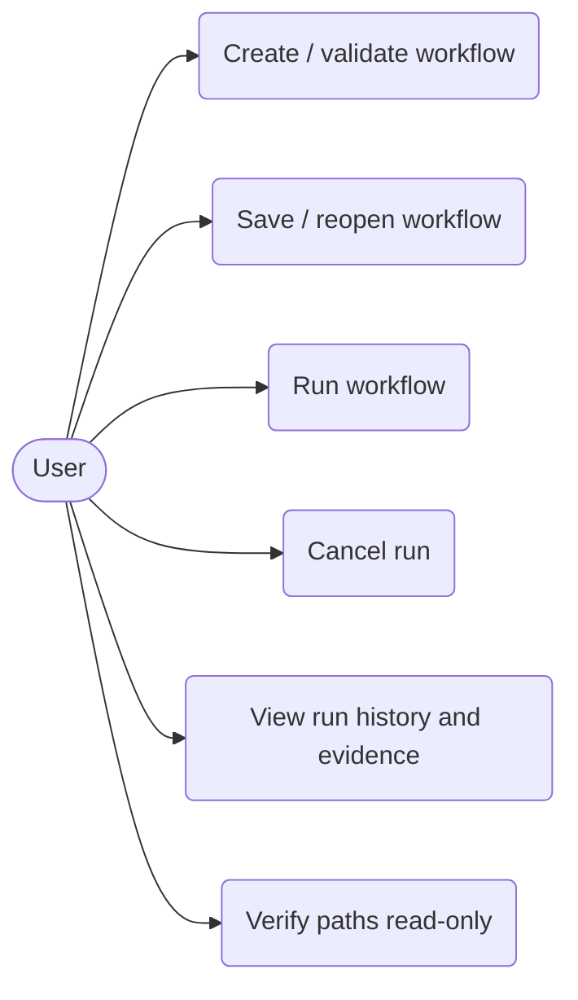
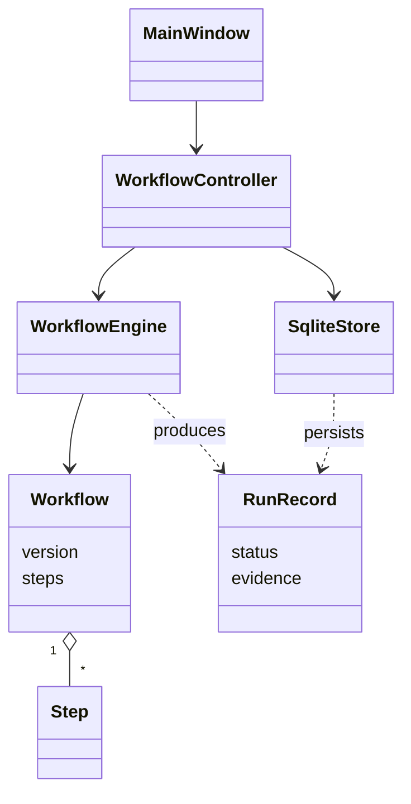
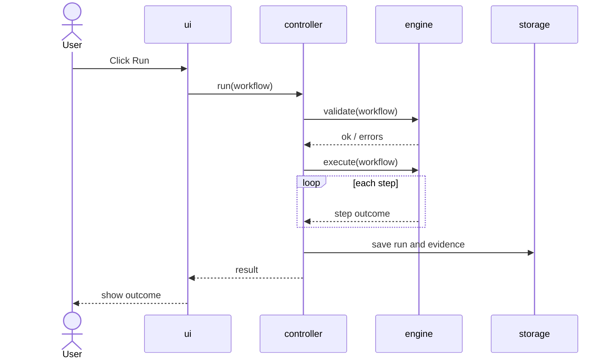
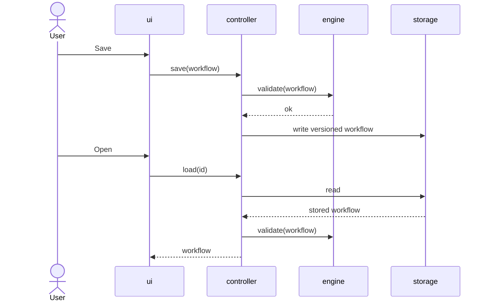
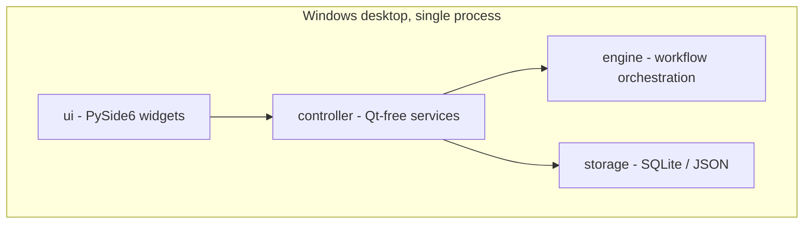

# Once: AI-Assisted Development Documentation

Draft for review before committing to `medamineessid/once` as `docs/ai_assisted_development.md`. Items marked **\[FILL\]** need your real information; I did not invent them.

## 1. Purpose and scope

This document records how AI tools are used to build **Once**, a local Windows desktop application for building and running bounded, observable workflows. It follows the course workflow: **plan → prompt → review → test → document**. It covers requirements, methodology, design (UML), implementation practices, refactoring, documentation, ethics, an AI usage log and the submission checklist.

The project's own safety rule applies to the AI process too: the deterministic engine decides what runs, and AI output never executes anything without human review.

## 2. AI workflow used in this project

| Stage | What we do | Where the evidence lives |
| --- | --- | --- |
| Plan | Define the milestone and its acceptance criteria before prompting | `AGENTS.md` (specification, safety invariants), backlog |
| Prompt | Give the AI the spec, constraints and the exact task; one task per prompt | Prompt text saved in the AI usage log (section 10) |
| Review | Read every diff; check it against the safety invariants and layering rules | Pull request review notes |
| Test | Run `pytest`, `ruff check`, `ruff format --check` and the offscreen smoke test | CI results, `tests/` |
| Document | Record decisions and what the AI produced vs. what a human changed | `docs/decisions.md`, `docs/ai_engineering_log.md` |

Rule of thumb: invest in good prompts, and invest more in code review. No AI-generated change is merged without a human reading it and a passing test run.

## 3. Requirements (AI-assisted)

### 3.1 Prompt used

> Act as a product analyst. Given: the Once README and `AGENTS.md` (a local Windows app that builds and runs bounded, observable, declarative workflows through a deterministic engine). Produce: (1) 5 user stories with acceptance criteria; (2) 5 nonfunctional requirements; (3) suggested priority (MoSCoW).

**Validation status:** the output below was drafted from the README. It must be checked against `AGENTS.md` and reviewed with real users or peers before it is final. **\[FILL: who reviewed it and what changed\]**

### 3.2 User stories and acceptance criteria

**US1: Define and validate a workflow.** As a user, I want to describe a workflow declaratively so that it can be checked before it runs.

- Invalid workflows are rejected with a clear message.
- A valid workflow is accepted without being executed.

**US2: Save and reopen a workflow.** As a user, I want to save a workflow and reopen it later so that I can reuse it.

- A saved workflow carries a version.
- Reopening restores exactly what was saved.

**US3: Run a workflow with bounded steps.** As a user, I want steps to run with visible outcomes so that I always know what happened.

- Each step ends as success, failure, skipped or cancelled.
- A failed step does not run the steps that depend on it.
- The user can cancel a running workflow.

**US4: See run history and evidence.** As a user, I want a record of every run so that I can audit it later.

- Each controller-triggered run is stored in SQLite with its evidence.
- History can be viewed in the GUI.

**US5: Verify paths read-only.** As a user, I want to confirm that expected files exist without changing anything.

- Only authorized paths can be checked.
- Verification never modifies the file system.

### 3.3 Nonfunctional requirements

1. **Safety:** the UI never mutates the file system; this build must not be used on real files.
2. **Determinism:** the same workflow and inputs produce the same step order and outcomes; no unrestricted scripts or opaque AI actions.
3. **Observability:** every run and step outcome is recorded with evidence.
4. **Testability and maintainability:** `engine/` stays free of Qt, UI, controller and storage imports (enforced by architecture tests); tests use only temporary folders.
5. **Portability:** Windows 10/11 x64, Python 3.14.

### 3.4 Priority (MoSCoW)

| Item | Priority |
| --- | --- |
| US1 validate, US2 save/reopen, US3 bounded run | Must |
| US4 history and evidence, US5 read-only verification | Must |
| File execution (real file operations) | Should |
| Undo of executed steps | Should |
| Browser, desktop-app, log and coding-tool integrations | Could |
| Unrestricted scripting or opaque AI actions | Won't (by design) |

## 4. Methodology selection

**Recommendation: Scrum with 2-week sprints** for a small team with a fixed course deadline. Choose Kanban instead only if work arrives continuously or changes frequently.

| Factor | This project |
| --- | --- |
| Team size | **\[FILL\]** |
| Deadline | **\[FILL\]** |
| Main risk | Safety of future file execution and undo, so small increments with review after each one suit it |

Proposed backlog sizing (T-shirt sizes suggested by AI; **a human must validate them**):

| Item | Size |
| --- | --- |
| File execution with the existing safety checks | L |
| Undo | L |
| One external integration (for example browser) | M |
| CI pipeline with coverage gate | S |
| User guide | S |

## 5. Design (UML)

The diagrams below are **conceptual**, built from the README's layers. Reconcile class and method names with the real code before committing. Commit the Mermaid source in `docs/diagrams/` and export PNG images alongside it, as the course asks.

### 5.1 Use-case diagram



### 5.2 Class diagram (conceptual)



### 5.3 Sequence diagram 1: run a workflow



### 5.4 Sequence diagram 2: save and reopen a workflow



### 5.5 Component diagram



## 6. Implementation practices

- **Style guide:** Ruff is the linter and formatter (`ruff check .`, `ruff format --check .`), configured in `pyproject.toml`.
- **Tests:** pytest with pytest-qt for the GUI and pytest-cov for coverage. Unit and integration tests are required for every feature. Tests only use `tmp_path` and never touch real folders.
- **Architecture guards:** tests enforce the dependency direction `ui → controller → (engine, storage)` and forbid file-system mutation calls in `ui/`.
- **Coverage target:** at least 60% (adjust to course policy).
- **AI coding assistants:** use them for boilerplate and small functions, then review every diff.
- **CI:** the README does not mention CI yet. Proposed GitHub Actions workflow, to be added at `.github/workflows/ci.yml`:

```yaml
name: CI
on: [push, pull_request]
jobs:
  test:
    runs-on: windows-latest
    steps:
      - uses: actions/checkout@v4
      - uses: actions/setup-python@v5
        with:
          python-version: "3.14"
      - run: python -m pip install -r requirements-dev.txt
      - run: ruff check .
      - run: ruff format --check .
      - run: python -m pytest -q --cov --cov-fail-under=60
        env:
          QT_QPA_PLATFORM: offscreen
```

## 7. Refactoring and optimization

AI may suggest refactors, but each one goes through a pull request and human review. Record before and after metrics for each refactor.

| Refactor (PR link) | Complexity before / after | Coverage before / after | Latency or memory | Lint issues fixed |
| --- | --- | --- | --- | --- |
| **\[FILL\]** |  |  |  |  |

Each refactor is also summarized in the Refactor & Optimization report.

## 8. Documentation plan

| Required document | Status | Notes |
| --- | --- | --- |
| README (purpose, run, architecture) | Exists | Add credentials/config note if any; confirm the system diagram |
| Developer docs (architecture, setup, style, contribution, CI) | Partial | Decisions and AI log exist in `docs/`; add contribution and CI steps |
| API docs | Adapt | Once is a desktop app with no HTTP API, so document the controller and engine interfaces instead; confirm this with your instructor |
| User guide | Missing | Short how-to: create, save, run, read history |
| Ethics and AI usage reflection | Drafted below | Section 9 |

All auto-generated documentation must be reviewed and corrected by a human before it is committed.

## 9. Ethics and AI usage reflection (draft)

**Where AI was used.** **\[FILL: list the tools and the tasks, for example requirements drafting, boilerplate, tests, documentation.\]** The repository contains `AGENTS.md` and an AI engineering log, so describe how AI coding agents were directed with them.

**Risks considered.**

- *Incorrect or unsafe code:* mitigated by human review of every diff, the architecture tests and the safety invariants in `AGENTS.md`.
- *Data loss:* file execution and undo are not implemented yet, and the README warns against using the build on real files. Any future file-changing feature needs explicit authorization checks and tests that use temporary folders only.
- *Over-trust in AI output:* estimates, requirements and diagrams drafted by AI are validated by people.
- *Privacy:* do not paste secrets, personal data or private files into AI tools. **\[FILL: confirm\]**

**License and IP.** Dependencies are pinned (PySide6, send2trash, and the development tools listed in the README); check each license before distribution, in particular PySide6's LGPL terms. AI-generated code is treated as the author's responsibility, reviewed and tested before commit. **\[FILL: the license you chose for the repository\]**

**Academic honesty.** AI use is disclosed in the usage log below, and AI output is flagged wherever it was used directly.

## 10. AI usage log

Keep this log current. The existing `docs/ai_engineering_log.md` can serve as the source for entries.

| Date | Tool | Prompt (or link) | Output used | Human changes |
| --- | --- | --- | --- | --- |
| **\[FILL\]** |  |  | direct / edited / discarded |  |

## 11. Submission checklist

| Item | Status |
| --- | --- |
| Git repo URL with commit/PR history | Public repo exists with 29 commits on `main`; PR history **\[FILL\]** |
| Project proposal PDF and backlog | **\[FILL\]** |
| UML diagrams (images and Mermaid/PlantUML source) | Source drafted in section 5; images and files still to export and commit |
| Working code with tests and CI passing | Tests exist; CI workflow proposed in section 6 |
| Refactor and optimization report with metrics | **\[FILL\]** |
| Documentation (README, API, developer) | README exists; see section 8 |
| AI usage log | Template in section 10 |
| Final presentation slides and recorded demo | **\[FILL\]** |
| Signed academic honesty statement | **\[FILL\]** |

## 12. To verify before pushing

1. Reconcile section 3 with `AGENTS.md`.
2. Rename classes and methods in section 5 to match the real code, then export images.
3. Fill every **\[FILL\]** item.
4. Confirm with your instructor how to handle "API docs" for a desktop app.
5. Add the CI workflow and confirm it passes.
